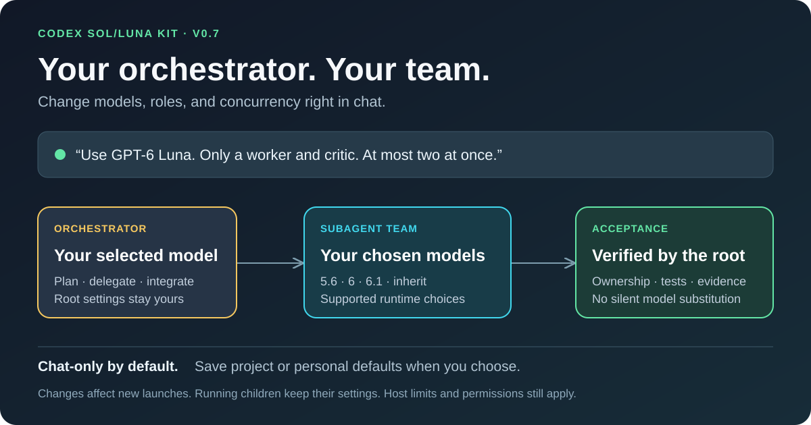

# Codex Sol/Luna Orchestration Kit

[](https://github.com/msinclair25/codex-sol-luna-orchestration-kit/actions/workflows/ci.yml)
[](https://github.com/msinclair25/codex-sol-luna-orchestration-kit/releases/latest)
[](LICENSE)



**Keep your orchestrator. Change your team in chat.**

V0.7 lets your selected Codex model coordinate a team whose models, roles, and
concurrency you control conversationally. Choose supported GPT-5.6, GPT-6, or
GPT-6.1 models independently of the orchestrator—or inherit its model.
Exact availability and reasoning levels come from your active Codex runtime,
not a hardcoded promise that every family has every variant.

The kit adds selective delegation, clear ownership, acceptance checks, and
small local evidence records around Codex's native subagents. It does not
replace Codex's model picker or require a routing dashboard.

## Quick Start

Requires Python 3.11+ and a Codex build/account with plugins, skills, and native
cross-model subagents. Paste into Codex:

```text
Install and fully configure the Sol/Luna Orchestration Kit.
Use https://github.com/msinclair25/codex-sol-luna-orchestration-kit, marketplace sol-luna, plugin sol-luna-orchestration-kit@sol-luna.
Verify codex plugin list --json and the matching source.path, then read its setup skill.
Preview, apply, and verify; preserve my root model and unrelated settings.
Require no intermediate restart; tell me if one final restart is needed.
```

Then configure it in the same chat:

| Want to… | Say… |
| --- | --- |
| Choose a model | “Use GPT-6 Luna for subagents.” |
| Try another model | “Use GPT-6.1 Sol subagents for this chat.” |
| Match the orchestrator | “Have subagents inherit my model.” |
| Simplify the team | “Only use a worker and a critic, at most two at once.” |
| Customize a role | “Add a security reviewer; use GPT-6 Astra for that role.” |
| Save for a project | “Save this team for this project.” |
| Save personal defaults | “Make this my default team.” |
| Inspect | “Show my team and which settings are saved.” |

Unqualified changes are **chat-only**. Saved precedence is chat → project →
personal → kit defaults. Changes apply to subsequent launches, not children
already running. No restart is needed for team-setting changes after the skill
is loaded; installing or updating plugin code may require one.

Fresh defaults: GPT-6 Luna, its advertised default reasoning, five available
roles (scout, worker, critic, tester, analyst), and at most three concurrent
children—also bounded by the host's actual capacity. Available roles are not
automatically launched. Small or tightly coupled tasks stay with the root.
Migration preserves GPT-5.6 Luna as the initial team model for existing installs.

## Setup from a checkout

Install the plugin for the conversational skills:

```sh
codex plugin marketplace add msinclair25/codex-sol-luna-orchestration-kit
codex plugin add sol-luna-orchestration-kit@sol-luna
```

The plugin alone supplies the workflow. To install or migrate managed root
instructions from this checkout:

```sh
python3 scripts/setup.py --preview-only
python3 scripts/setup.py
python3 scripts/setup.py --doctor
```

On Windows use `py -3` instead of `python3`, or
`pwsh -NoProfile -File .\scripts\windows_setup.ps1`. Add `-PreviewOnly` for a
preview. No WSL, runtime installation, or third-party Python package is needed.

Setup preserves `config.toml`, including the selected root model, reasoning,
speed, provider, and permissions. Known managed legacy role files become
unpinned compatibility aliases. Edited managed files stop migration for review;
existing files receive backups. `--update` is idempotent. Historical Fast/Standard
installation remains explicitly available through `--legacy`, not by default.
Untracked old fixed-model instructions also stop setup for manual review; the
installer will not guess ownership or layer contradictory policies over them.

## How it works

The root resolves settings, selects independently useful work, assigns bounded
ownership, launches fresh-context generic agents with the exact supported
model/effort, and verifies the results. A role is instructions plus optional
model/effort overrides—not a hardcoded model-pinned custom agent.

Unsupported selections are reported, never silently substituted. `inherit`
omits both model and reasoning overrides. If the user's generic `default` role
has conflicting pins, the workflow reports that conflict and works directly.
Custom roles and current settings do not depend on hot-reloading agent TOMLs.

Read-only roles are behavioral instructions, not separate sandboxes. Children
inherit actual host permissions and service tier. The hook is a partial
admission guard on supported `Agent` surfaces, not universal enforcement or a
security boundary. The root still checks ownership and acceptance.

## Settings and evidence

Project settings live in `.codex/sol-luna-team.json`; personal settings live in
`CODEX_HOME/sol-luna-team.json` (normally `~/.codex`). These are kit preferences,
not native Codex configuration keys. Explicit saves create recoverable backups;
chat-only overrides write nothing. Role sets replace the previous set at the
selected scope, so removing a role is unambiguous.

`$sol-luna-status` shows the current team and bounded project-local records.
Receipts under `.sol-luna/team-receipts` distinguish requested models from
runtime-observed execution. Missing telemetry stays unknown. Token totals cover
recorded lanes only, never whole-workflow usage or billed cost. No savings
claim, private session scan, or hosted telemetry is included.

Historical policies, receipts, and rate cards remain readable but do not govern
current teams. See [Technical history](docs/TECHNICAL_HISTORY.md). The old
`AGENTS.md` is frozen evidence; `AGENTS.override.md` is the active repository
guidance. Historical reference documents are not current setup instructions.

## Verification and feedback

```sh
python3 scripts/sync_plugin.py
python3 -m unittest discover -s tests -v
git diff --check
```

CI runs Python 3.11–3.14 on Windows, macOS, and Linux, including isolated setup
and migration tests. See the [V0.7 plan and acceptance checklist](docs/V0.7_PLAN.md)
for release validation. Runtime availability still depends on your Codex host.
Report your Codex version, OS, requested team, expected behavior, and sanitized
result in [an issue](https://github.com/msinclair25/codex-sol-luna-orchestration-kit/issues).
Never include credentials, private prompts, customer data, or production logs.

This is an independent community project, not an official OpenAI product.
Native delegation behavior is documented in
[Codex subagents](https://learn.chatgpt.com/docs/agent-configuration/subagents);
model availability is described in [Codex models](https://learn.chatgpt.com/docs/models).

Licensed under [MIT](LICENSE). See [SECURITY.md](SECURITY.md) for security reports.
